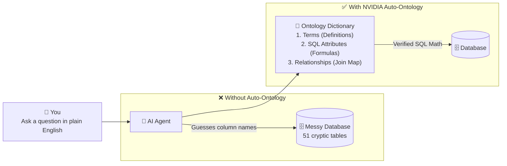
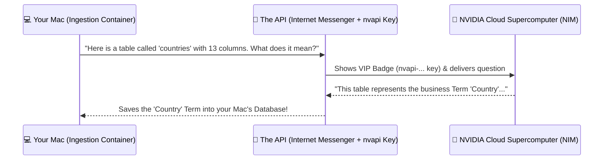
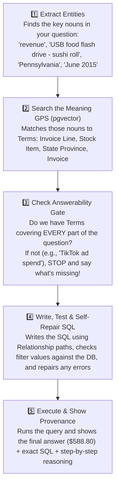

# 🎓 Zero-to-Hero Course: What Is NVIDIA Auto-Ontology & How Does It Work?

**Welcome!** If words like *"Docker"*, *"Port 5433"*, *"Postgres"*, *"Embeddings"*, *"API"*, and *"Semantic Compilation"* sound like a foreign language right now—**that is 100% normal.**

Software engineers love inventing complicated words for very simple ideas. In this Coursera-style course, we strip away all the jargon and explain **every single thing** using everyday high-school analogies, followed by hands-on exercises you can do right in your web browser and terminal.

---

## 🧭 Course Map

| Module | Lesson Title | The Big Question We Answer | Hands-On Lab |
| :--- | :--- | :--- | :--- |
| **Module 1** | **The Big Picture: Why Does This Program Exist?** | Why does normal AI lie about numbers, and what problem does NVIDIA Auto-Ontology solve? | Explore the raw `wideworldimporters` database tables on your Mac. |
| **Module 2** | **What Did We Set Up on Your Mac? (Step-by-Step)** | What are Docker, Containers, Ports, `.env`, and Databases in plain English? | Inspect your running Docker containers and health endpoints. |
| **Module 3** | **What Is an API & What Does Your `nvapi-...` Key Do?** | Why did we need a key from NVIDIA, and what are the 4 Cloud AI brains doing? | Watch the Embedding & Reasoning models work in real time. |
| **Module 4** | **Inside the Program: What Is an "Ontology"?** | What are Terms, SQL Attributes, and Relationships in plain English? | Trace a 5-table join path and browse the Semantic Graph in the UI. |
| **Module 5** | **From Raw Database to Certified Ontology (Generate & Certify)** | How does Semantic Compilation build a draft dictionary, and why do humans "certify" it? | Turn on Semantic Compilation, inspect AI-generated Terms, and certify a Term. |
| **Module 6** | **How the AI Answers Questions Without Lying (Plus MCP & API)** | How does the Chat box turn English into verified database math, and how do other agents connect? | Test answerable vs. unanswerable questions in Chat, mint an API token, and complete the Capstone Project. |

---

# 📘 Module 1: The Big Picture — Why Does This Program Exist?

### 1.1 The "Spreadsheet Chaos" Analogy
Imagine your high school is running a massive bake sale across 10 different clubs:
- The **Chess Club** records sales in a spreadsheet called `tbl_ch_tx` with a column named `amt_net`.
- The **Drama Club** records sales in a spreadsheet called `orders_final_v2` with columns `price` and `qty`.
- Some rows are **cancelled orders**, and some prices are recorded in **cents** while others are in **dollars**.

Now imagine the Principal walks in and asks an AI assistant (like ChatGPT):
> *"What was our total revenue last Friday?"*

If you connect a normal AI directly to those messy spreadsheets:
1. The AI looks at `amt_net` and `price` and **guesses** which column means "revenue."
2. It forgets to filter out cancelled orders or old backup tables (`_archive`), counting sales **twice**.
3. It gives an answer in 2 seconds—say, **\$45,210.00**—and sounds 100% confident. **But the number is completely wrong.** In business, a fast wrong number is worse than no answer at all.

### 1.2 Key Vocabulary (High-School Edition)
Let's translate the fancy tech words into plain English:

- **Relational Database (PostgreSQL):** A super-powered collection of Excel spreadsheets (called **tables**) that link to each other using ID numbers (like `Student_ID` or `Invoice_ID`).
- **SQL (Structured Query Language):** The programming language used to ask a database for exact math (for example: `SELECT SUM(extendedprice) FROM sales.invoicelines`).
- **Text-to-SQL:** Using an AI to translate a normal English question (*"What was revenue in June?"*) into SQL code automatically.
- **Ontology (The Semantic Layer):** Do not let the Greek word scare you! An **Ontology** is simply a **Smart Business Dictionary + Map**. It sits *between* the messy database and the AI, telling the AI:
  1. **What things mean:** *"When someone says 'Product', look at the `warehouse.stockitems` table, NOT `warehouse.stockitems_archive`."*
  2. **How to calculate metrics:** *"When someone asks for 'Revenue', always use the formula `SUM(il.extendedprice)`."*
  3. **How tables connect:** *"To link an Invoice Line to a US State, walk through Invoice → Customer → City → State Province."*



---

### 🛠️ Module 1 Hands-On Lab: Peek Inside the Messy Database
When we set up your Mac, we loaded a famous Microsoft practice database called **Wide World Importers (WWI)**—a fictional novelty-goods wholesaler that sells items like *"USB food flash drive - sushi roll"* to stores across the United States.

**Exercise 1.1:** Open your Mac Terminal and run this command to list all the folders (`schemas`) and spreadsheets (`tables`) inside `wideworldimporters`:
```bash
/Applications/Docker.app/Contents/Resources/bin/docker exec -it postgres \
  psql -U postgres -d wideworldimporters -c "\dn" -c "\dt *.*"
```

**What to observe:**
- There are **4 business folders (schemas)**: `application`, `purchasing`, `sales`, and `warehouse`.
- Almost every table has an `_archive` twin (like `sales.customers` and `sales.customers_archive`).
- There are both `sales.orders` (what customers ordered) and `sales.invoices` (what was actually billed).
- **Takeaway:** Without an Ontology dictionary, an AI has to guess which table means what!

### ✅ Module 1 Quick Quiz
1. **Why can't we just let a regular AI guess what database columns mean?**
   - *A)* Because AI can't do addition.
   - *B)* Because database column names are cryptic/ambiguous (like `_archive` tables or multiple city IDs), and guessing leads to wrong business numbers.
   - *(Correct Answer: **B**)*

---

# 📘 Module 2: What Did We Set Up on Your Mac? (Step-by-Step in Plain English)

Let's translate **every single step** we ran on your Mac so there is zero mystery!


### Step 1: Why Your Mac Can Run an NVIDIA Program Without an NVIDIA GPU
- Your Mac has an Apple Silicon chip (`arm64`) and **48 GB of memory (RAM)**.
- **Why you don't need an NVIDIA graphics card:** The heavy AI thinking happens on NVIDIA's cloud supercomputers over the internet (called **NVIDIA NIM**). Your Mac only needs to run the website and the database!

### Step 2: What Is "Docker" & What Are "Containers"?
- **The Problem:** Installing a big software project normally requires installing dozens of exact versions of Python, Node.js, and PostgreSQL on your laptop. If one version is wrong, everything crashes.
- **The Solution (Docker):** Docker packs each piece of software into a self-contained "shipping container" (a mini virtual computer) that already has the exact tools it needs inside.
- **The 4 Containers Running on Your Mac ([`docker-compose.yml`](../docker-compose.yml)):**

| Container Name | Port (Door #) | Everyday Analogy | What It Does |
| :--- | :--- | :--- | :--- |
| **`auto-ontology-frontend`** | `3000` | **The Front Desk & Security Guard** | Draws the website you see in your browser (`http://localhost:3000`), handles login, and is the **only safe public doorway** for API requests. |
| **`auto-ontology`** | `3001` | **The Detective (Query Engine)** | Takes your English question, checks the Ontology dictionary, writes SQL code, verifies it, runs it, and explains the answer. |
| **`auto-ontology-ingestion-service`** | `3002` | **The Dictionary Builder** | Reads your connected databases, profiles the columns, and asks the NVIDIA AI to build the first draft of your Ontology. |
| **`postgres` (`pgvector:pg17`)** | `5433` (host) → `5432` (inside Docker) | **The Digital Filing Cabinet** | Stores both your app's Ontology dictionary (`auto_ontology` database) and the sample company data (`wideworldimporters` database). |
| **`pgadmin`** | `5050` | **The Microscope** | An optional visual tool to browse raw database tables. |

### Step 3: What Are "Ports" (`3000`, `5432`, `5433`)?
- **The Apartment Building Analogy:** Think of your Mac (`localhost`) as an apartment building. Since multiple programs run inside your Mac at the same time, each program needs its own **Apartment Door Number (Port)**:
  - Door **`3000`** (`http://localhost:3000`) is the **Auto-Ontology Website**.
  - Door **`5432`** is the standard door for PostgreSQL databases. When we checked your Mac, you already had another Postgres app using Door `5432`. So we gave our Docker Postgres container Door **`5433`** on your Mac so they wouldn't collide!

### Step 4: What Is the `.env` File?
- In the project folder, we created a hidden text file named `.env` (copied from [`.env.example`](../.env.example)).
- **Analogy:** Think of `.env` as the **Settings & Passwords Sticky Note** that the containers read when they wake up.
- It stores your login email (`AUTO_ONTOLOGY_ADMIN_EMAIL`), login password (`AUTO_ONTOLOGY_ADMIN_PASSWORD`), database password (`POSTGRES_PASSWORD`), and your NVIDIA API key (`DEFAULT_MODELS_API_KEY`).

---

### 🛠️ Module 2 Hands-On Lab: Inspect Your Running Containers

**Exercise 2.1 — See the Containers in Docker Desktop:**
1. Open the **Docker Desktop** app on your Mac and click **Containers** on the left.
2. Expand `auto-ontology`—you will see all your mini-computers running with green status dots!

**Exercise 2.2 — Knock on Each Container's Door from Terminal:**
Run these commands in your Mac Terminal to verify each container replies `200 OK`:
```bash
# 1. Check the Detective (Backend API on port 3001)
curl -i http://localhost:3001/api/health/live

# 2. Check the Dictionary Builder (Ingestion Service on port 3002)
curl -i http://localhost:3002/health/live

# 3. Check the Front Desk (Frontend OAuth server discovery on port 3000)
curl -s http://localhost:3000/.well-known/oauth-authorization-server | python3 -m json.tool
```

---

# 📘 Module 3: What Is an API & What Does Your `nvapi-...` Key Do?

### 3.1 What Is an API? (The Restaurant Waiter Analogy)
**API** stands for *Application Programming Interface*, which is a fancy name for a very simple idea:
- Imagine you are sitting at a restaurant table (**your Mac**).
- The kitchen (**NVIDIA's giant AI supercomputer in the cloud**) is across town.
- An **API** is simply the **Waiter (Messenger)** that takes a message from your Mac, sends it over the internet to NVIDIA's supercomputer, and brings the AI's answer back to your Mac!



### 3.2 What Is Your `nvapi-...` Key?
NVIDIA's cloud supercomputers cost millions of dollars to run, so they don't let anonymous computers use them without an account.
- Your **`nvapi-...` key** is your **VIP Badge / Digital Library Card**.
- Every time your Mac sends a request to NVIDIA's API (`https://integrate.api.nvidia.com/v1`), it shows that VIP badge so NVIDIA lets the request through.

### 3.3 The 4 Specialized AI Brains Behind Your Key
Instead of using one AI model for everything, Auto-Ontology uses **4 specialized AI roles**:

1. **`REASONING` (`nvidia/nemotron-3.5-lightning-30b-a3b`):** The **Senior Professor**. Reads your database tables, invents business Terms, writes complex SQL queries, and grades whether a question is answerable.
2. **`NON_REASONING` (`nvidia/nemotron-3.5-lightning-30b-a3b`):** The **Speed Reader**. Quickly spots the key nouns in your question and runs fast SQL validation checks.
3. **`EMBED` (`nvidia/nemotron-3-embed-1b`):** The **Meaning GPS Maker**.
   - **What does "Embedding" mean?** Computers don't naturally know that the words *"Revenue"*, *"Income"*, and *"Extended Price"* have related meanings.
   - An **Embedding Model** turns every word or description into a **GPS coordinate of meaning** (a list of 2,048 numbers stored in `pgvector`).
   - Concepts with similar meanings get placed right next to each other on the GPS map! When you ask about *"Revenue"*, the computer checks the GPS map and immediately finds the `extendedprice` column!
4. **`RERANK` (`nvidia/nemotron-3.5-rerank-8b`):** The **Final Judge**. When the GPS search finds 20 possible tables, the Reranker sorts them from best match to worst match.

---

# 📘 Module 4: Inside the Program — What Is an "Ontology"?

Every Ontology in Auto-Ontology is built out of just **3 building blocks**. If you understand these 3 things, you understand the entire system!


### Building Block 1: Terms (The Business Nouns / Sticky Notes)
Imagine walking into a messy warehouse and putting clean English sticky notes on every shelf:
- The raw database has a cryptic table called `warehouse.stockitems`.
- Auto-Ontology creates a **Term** called **"Stock Item"** with a clear English description and synonyms (*product*, *item*), mapped to the columns of `warehouse.stockitems`.
- Remember how the database also had `application.cities` and `application.cities_archive`? Auto-Ontology creates separate Terms for **"City"** vs. **"Archived City"** so the AI never mixes up live data with old historical backups!

### Building Block 2: Relationships (The Red Yarn Connecting the Clues)
Have you ever seen a detective movie where the detective pins photos to a corkboard and connects them with red yarn?
- In `wideworldimporters`, the `sales.invoicelines` table has **no column for US State**!
- To find out which US State an invoice line belongs to, you have to hop across **5 tables**:
  `sales.invoicelines` → `sales.invoices` → `sales.customers` → `application.cities` → `application.stateprovinces`
- Even trickier: `sales.customers` has **two** city columns (`deliverycityid` and `postalcityid`).
- A **Relationship** is the red yarn that tells the AI the exact legal path to join tables together.

### Building Block 3: SQL Attributes (The Pre-Programmed Calculator Buttons)
Imagine your math teacher lets you program a special button on your calculator for a tricky formula so you never make a typo during the final exam.
- A **SQL Attribute** is a saved, verified SQL math formula attached to a Term (for example, `Revenue = SUM(extendedprice)` under **Invoice Line**).
- Whenever anyone asks about Revenue, the AI reuses that exact formula so every report in the company matches 100%.

---

### 🛠️ Module 4 Hands-On Lab: Run the 5-Table Hop Yourself!
Let's see the exact 5-table SQL query that connects an **Invoice Line** to a **Product** (`Stock Item`) and a **US State** (`State Province`):

**Exercise 4.1:** Copy and paste this command into your Mac Terminal:
```bash
/Applications/Docker.app/Contents/Resources/bin/docker exec -it postgres \
  psql -U postgres -d wideworldimporters -c "
SELECT
    SUM(il.extendedprice) AS revenue,
    COUNT(*) AS invoice_lines
FROM sales.invoicelines il
JOIN sales.invoices i              ON il.invoiceid = i.invoiceid
JOIN warehouse.stockitems si       ON il.stockitemid = si.stockitemid
JOIN sales.customers c             ON i.customerid = c.customerid
JOIN application.cities ct         ON c.deliverycityid = ct.cityid
JOIN application.stateprovinces sp ON ct.stateprovinceid = sp.stateprovinceid
WHERE si.stockitemname = 'USB food flash drive - sushi roll'
  AND sp.stateprovincename = 'Pennsylvania'
  AND i.invoicedate >= '2015-06-01' AND i.invoicedate < '2015-07-01';
"
```
**Expected Output:**
```text
 revenue | invoice_lines 
---------+---------------
  588.80 |             3
```
You just proved straight from the raw database that in June 2015, Pennsylvania stores bought **\$588.80** of sushi-roll USB flash drives across **3 invoice lines**!

---

# 📘 Module 5: Generate & Certify — Building a Trustworthy Dictionary

Nobody wants to type 589 column definitions by hand. Auto-Ontology uses a two-step workflow:

1. **Generate (AI Draft — Semantic Compilation):**
   - When you toggle **Settings → Semantic Compilation** ON in the Web UI, the `ingestion-service` container walks through all 51 tables one by one.
   - For each table, it samples real rows, detects foreign keys, asks the NVIDIA LLM to invent **Terms** and descriptions, and embeds them into `pgvector`.
2. **Certify (Human Approval):**
   - The AI's first draft is a huge time-saver, but a human boss (you!) is still in charge.
   - In the Web UI, you can inspect any Term, edit its description or SQL Attributes, and click **Certify**—which stamps it as an official, human-verified company definition.

---

### 🛠️ Module 5 Hands-On Lab: Watch & Certify Your Ontology in the Browser

**Exercise 5.1 — Watch the Terms Grow in Your Browser:**
1. Open **http://localhost:3000** and sign in (`admin@nvidia.com`).
2. Click on **Settings → Semantic Compilation** to check the compilation progress.
3. Click on the **Catalog / Ontology (Glossary)** tab in the left sidebar.
4. Click on any Term that has been generated (such as **City** or **Country**) and read the English description and column descriptions the AI wrote!

**Exercise 5.2 — Check Compilation Progress from Terminal:**
Want to see how many Terms, Column Attributes, SQL Attributes, and Relationships have been created so far? Run this in your Terminal:
```bash
/Applications/Docker.app/Contents/Resources/bin/docker exec -it postgres \
  psql -U postgres -d auto_ontology -c "
SELECT
  (SELECT count(*) FROM term) AS terms,
  (SELECT count(*) FROM column_attribute) AS column_attributes,
  (SELECT count(*) FROM sql_attribute) AS sql_attributes,
  (SELECT count(*) FROM column__semantic_fk) AS semantic_fks;
"
```

**Exercise 5.3 — Export Your Ontology as a Backup File:**
1. In the Web UI (`http://localhost:3000`), go to **Settings → Import / Export**.
2. Export your ontology as YAML (supports both native Auto-Ontology format and the open [Apache Ossie](https://ossie.apache.org/) standard).
3. Open the downloaded `.yaml` file in any text editor to see how your entire business dictionary can be saved and shared as a simple text file!

---

# 📘 Module 6: How the AI Answers Questions Without Lying (Plus MCP & API)


### 6.1 The 5-Step Verification Pipeline in Chat
When you type a question into **Chat** at `http://localhost:3000`, Auto-Ontology does **not** just guess an answer. It runs 5 strict steps:



### 6.2 How Other AI Agents Connect (MCP & REST API)
Not only can humans use the Chat box in the browser, but external AI agents (like Cursor, Claude Desktop, or custom Python scripts) can connect to Auto-Ontology too!

1. **MCP Server (Model Context Protocol):**
   - Gives AI coding assistants **read-only tools** (`check_readiness`, `search_terms`, `check_answerable`, `ask_question`).
   - Why is MCP **read-only**? So a rogue AI agent can safely look up definitions and ask questions without **ever** being able to delete or alter your company's official Ontology!
2. **REST API (`http://localhost:3000/api/...`):**
   - Allows Python scripts and automated pipelines to call Auto-Ontology using an API token (`x-api-key`) that you create under **User Menu → API Tokens** in the UI.

---

### 🛠️ Module 6 Hands-On Lab & Final Capstone Challenge

#### Part A: Test Answerable vs. Unanswerable Questions in Chat
*(Wait until **Settings → Semantic Compilation** shows that compilation has finished!)*

1. Open **Chat** at `http://localhost:3000` and ask:
   > `What was revenue for the USB food flash drive - sushi roll in Pennsylvania in June 2015?`
   - Verify that it returns **`$588.80`** (matching the SQL query you ran manually in Module 4!) and click to inspect the **SQL** and **Steps**.
2. Now test the **Answerability Gate** by asking a trick question:
   > `What was return on ad spend for the sushi roll flash drive in June 2015?`
   - Watch how the agent recognizes that `wideworldimporters` has **no advertising spend data** and refuses to hallucinate a fake number!

#### Part B: Call the API Yourself from Terminal
1. In the Web UI (`http://localhost:3000`), click your **User Profile icon → API Tokens** and create a new token.
2. In your Mac Terminal, paste your token and ask the API for your glossary terms:
   ```bash
   export AUTO_ONTOLOGY_API_TOKEN="paste-your-token-here"

   curl -s "http://localhost:3000/api/terms?limit=5" \
     -H "x-api-key: $AUTO_ONTOLOGY_API_TOKEN" | python3 -m json.tool
   ```

#### 🏆 Part C: Final Capstone Challenge — "The CFO's Audit"
Imagine the CFO of Wide World Importers tells you:
> *"Whenever our team asks for **Average Invoice Line Value**, different people calculate it differently. Add an official, certified SQL Attribute for it so the AI uses the same formula every time."*

1. Go to the **Ontology / Terms** page in `http://localhost:3000` and open the **Invoice Line** term.
2. Add a new **SQL Attribute** named `Average Invoice Line Value` with the SQL expression `AVG(extendedprice)`.
3. Mark it **Certified**.
4. Go to **Chat** and ask: *"What was the average invoice line value across each customer category in 2015?"* and check the generated SQL to see your certified formula in action!

---

## 📎 Quick Reference Cheat Sheet (For Your Mac)

| What You Want to Do | Terminal Command |
| :--- | :--- |
| **See all running containers** | `/Applications/Docker.app/Contents/Resources/bin/docker compose ps -a` |
| **Watch the AI build the Ontology live** | `/Applications/Docker.app/Contents/Resources/bin/docker compose logs -f ingestion-service` |
| **Watch Backend API logs live** | `/Applications/Docker.app/Contents/Resources/bin/docker compose logs -f auto-ontology` |
| **Pause containers (without losing data)** | `/Applications/Docker.app/Contents/Resources/bin/docker compose stop` |
| **Start containers again** | `/Applications/Docker.app/Contents/Resources/bin/docker compose start` |
| **Open PostgreSQL prompt on `wideworldimporters`** | `/Applications/Docker.app/Contents/Resources/bin/docker exec -it postgres psql -U postgres -d wideworldimporters` |
